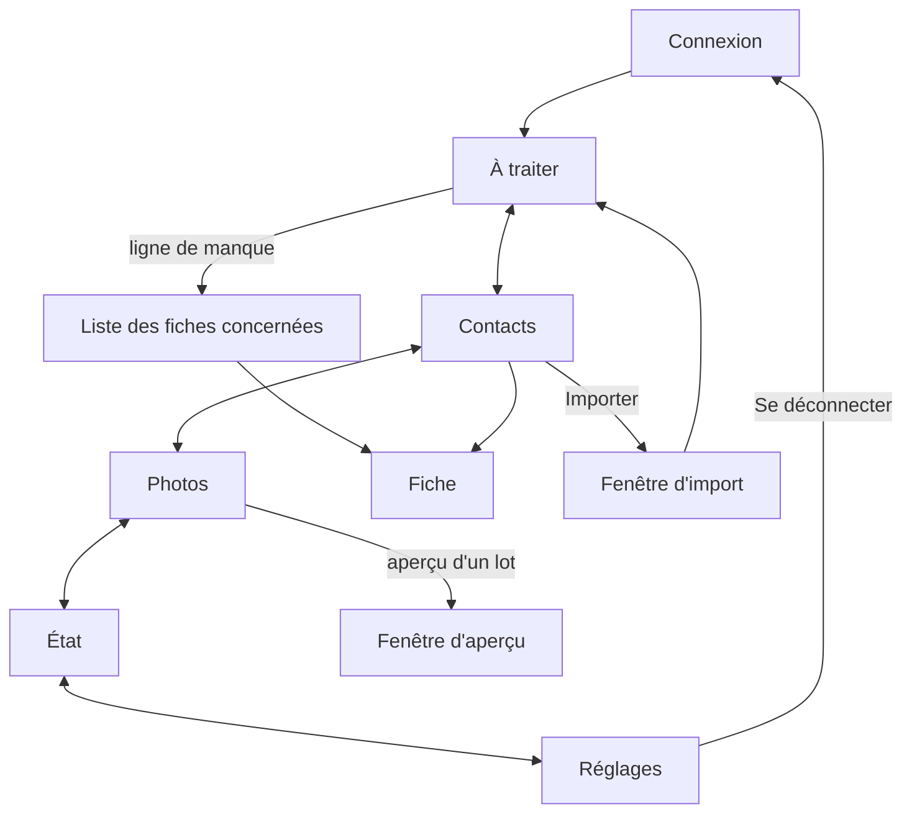

# carnet 2.8.0 — dossier (parcours et complétude)

Rédigé le 11/11/2026. Version : 1, avant passage au conseil.

Sources : `docs/2.8-grill.md` (décisions de Julien), `docs/sonde-2.8.md` (mesures sur les vraies données), `docs/dossier.md` (carnet tel que construit en 2.7.1). Ce dossier ne répète pas ce qui ne change pas.

Une seule livraison. Rien n'est codé avant le conseil et le plan validé.

---

## 1. Besoin

**Le problème.** carnet sait corriger une fiche, pas dire ce qu'il lui manque. La complétude actuelle applique les quatre mêmes critères à tout le monde : un client sans année de naissance est signalé, un proche sans photo ne l'est pas. Les photos se traitent fiche par fiche. L'import a deux entrées. La fiche ignore des informations que l'iPhone sait porter.

**Ce que la 2.8.0 apporte.**

| # | Fonction | En une phrase |
|---|---|---|
| 1 | Attentes par groupe | Un tableau dit quelles informations chaque groupe doit avoir ; il est prérempli et se règle dans l'appli |
| 2 | Manques | À traiter gagne une famille « Manques » : une ligne par information manquante, avec son nombre de fiches |
| 3 | Exceptions | Sur une fiche, « normal pour ce contact » fait taire un manque précis |
| 4 | Onglet Photos | Portraits, affiches iPhone et logos pour plusieurs contacts à la fois |
| 5 | Import unique | Un seul bouton Importer ; carnet reconnaît le fichier et annonce ce qu'il en fera |
| 6 | Champs nouveaux | Service dans la société, prononciation du nom, fête, date de mariage |
| 7 | Fête | Déduite du prénom, écrite dans iCloud, annoncée par Home Assistant pour les groupes choisis |
| 8 | Mariage | Même date dans iCloud et Treemich, dans les deux sens, sans validation |
| 9 | Décès et divorce | Lus dans Treemich ; ils arrêtent les annonces et les manques |
| 10 | Onglet Réglages | Cinquième onglet : attentes, annonces, connexions aux réseaux, déconnexion |

**Ce que la 2.8.0 ne fait pas.** Nom de naissance, deuxième prénom, date de rencontre, dernier contact, rappels : écartés. Pas de connexion unique. Pas de suppression automatique. Aucune écriture d'un décès ou d'un divorce. Pas de logo posé sans aperçu.

**Réussi si**, après une semaine :

- Julien règle le tableau des attentes sans aide ;
- la famille « Manques » tient en moins de douze lignes et chaque ligne mène à une liste où il peut agir ;
- les logos des clients et des artisans se posent par lots, et la ligne « Sans photo ni logo » baisse nettement ;
- aucune écriture non voulue dans iCloud ni dans Treemich.

---

## 2. Technique

Pile inchangée : FastAPI, SQLite, Svelte 5, Tailwind 4, image en 3 étapes, port 8096, Watchtower désactivé.

### Ce que la sonde a mesuré (étape 0)

| Constat | Conséquence |
|---|---|
| 563 fiches, aucune validée | La validation d'une fiche entière ne sert pas aujourd'hui ; elle est gardée mais ne porte pas la conception |
| 437 fiches incomplètes avec le tableau de départ, dont 406 faute de photo ou de logo | La ligne « Sans photo ni logo » sera énorme le premier jour ; l'onglet Photos est le moyen de la réduire |
| Hors photo : 59 sans téléphone, puis moins de 20 fiches par ligne | La famille « Manques » reste lisible |
| Aucune fiche ne porte de date supplémentaire, de service ni de prononciation | Pas de reprise de données ; mais rien ne prouve encore qu'iCloud rend ces champs comme attendu |
| 63 fiches sans prénom (62 entreprises) | Ni fête ni naissance attendues pour une fiche d'entreprise |
| 36 prénoms composés ou en plusieurs mots | Il faut une règle pour la fête |
| Un groupe personnel de 46 contacts et « Moi » sans attentes | Le premier reçoit les attentes d'Amis ; « Moi » n'en a aucune |
| 51 contacts dans plusieurs groupes | Les attentes s'additionnent |
| Treemich : 13 couples, aucune date de mariage, aucun décès | Tout part de zéro ; les premières dates viendront de la saisie |

### Champs nouveaux dans la carte iCloud

| Information | Écriture dans la carte | Remarque |
|---|---|---|
| Service | Deuxième partie de `ORG` (`Société;Service`) | Champ natif |
| Prononciation | `X-PHONETIC-FIRST-NAME`, `X-PHONETIC-LAST-NAME` | Champs natifs d'Apple |
| Mariage | Date supplémentaire (`X-ABDATE`) avec le libellé natif « Anniversaire » d'Apple | S'affiche sous ce nom sur l'iPhone |
| Fête | Date supplémentaire avec un libellé libre « Fête », sans année | Apple note une date sans année avec l'an 1604 |

**À vérifier avant de coder le reste** : écrire ces quatre champs sur une carte d'essai, la relire, la regarder sur l'iPhone. Si la date sans année ou le libellé libre ne tiennent pas, la fête repasse en calcul sans écriture.

### Treemich

Lu dans le code source de Treemich le 11/11/2026.

| Besoin | Appel | Sens |
|---|---|---|
| Date de mariage et de divorce d'un couple | `GET /relationships` (déjà appelé par carnet) : `marriageAnniversaryDate`, `divorceDate` sur chaque lien de conjoint | Lecture |
| Écrire une date de mariage | `PATCH /people/<id>/relationships` avec `toPersonId` et `marriageAnniversaryDate` | Écriture |
| Décès | `deathDate` de la personne | Lecture |

Aucun appel supplémentaire par personne : la lecture du mariage ne coûte rien de plus que la nuit actuelle.

### Fête

- Un calendrier des fêtes est embarqué dans l'image (`app/fetes.json`) : prénom vers jour et mois. Pas d'appel réseau.
- Source de départ : le jeu « Les saints et fêtes du calendrier » de data.gouv.fr (Licence Ouverte). Publié par un particulier, sans documentation : il est contrôlé contre un second calendrier avant d'être embarqué, et les écarts sont tranchés à la main.
- Règle pour les prénoms : le prénom entier d'abord (« Jean-Baptiste » a sa propre fête) ; sinon son premier élément ; accents et casse ignorés.
- Prénom introuvable : manque « Sans fête », avec deux réponses sur la fiche — saisir un jour, ou « normal pour ce contact ».
- Une fête saisie à la main n'est jamais remplacée par le calendrier.

### Garde-fous

- Toutes les écritures passent par la garde existante : mode lecture seule, verrou, contrôle de version de la carte, plafonds de nuit.
- Fêtes : une centaine d'écritures au premier passage (Famille, Amis et le groupe personnel). Elles s'étalent sur plusieurs nuits sous le plafond existant.
- Mariage : carnet retient la dernière date accordée pour chaque couple. Sans cette mémoire, il ne saurait pas dire lequel des deux côtés a changé.
- Mise en service en lecture seule le premier jour, comme pour la 2.7.0.

### Composants d'interface

shadcn-svelte entre dans carnet pour deux besoins : la fenêtre de dialogue (import, aperçu d'un lot de photos) et la case à cocher du tableau des attentes. TypeScript est ajouté pour ces seuls composants ; l'existant n'est pas converti.

---

## 3. Parcours des clics et des écrans

### Vue d'ensemble

**Navigation.** Cinq onglets : À traiter, Contacts, Photos, État, Réglages. Sur iPhone, icônes seules et nom de l'onglet actif, comme aujourd'hui. Sur PC, rail à gauche. La pastille d'À traiter ne compte que les décisions, jamais les manques.

### À traiter

Inchangé pour les décisions. Ajouts :

| Geste | Effet | Écran suivant |
|---|---|---|
| Pastille « Manques » | Affiche une ligne par manque : « Sans photo ni logo (406) », « Sans téléphone (59) »… et « Sans groupe » | À traiter |
| Ligne de manque | Ouvre Contacts filtré sur ce manque | Contacts |
| Ligne « Sans photo ni logo » | Propose aussi « Traiter dans Photos » | Photos |
| Point « Date de mariage manquante » (couple connu de Treemich, sans date) | Saisir la date ; ou « Pas de mariage ni PACS » | À traiter, point retiré |
| Point « Date différente » pour un mariage | Choisir une date, écrite des deux côtés ; ou Ignorer | À traiter, point retiré |

« Pas de mariage ni PACS » vaut pour le couple : la question n'est plus posée pour aucun des deux. Un filtre de Contacts retrouve ces fiches.

### Contacts

| Geste | Effet | Écran suivant |
|---|---|---|
| Pastilles de manque | Une par information du tableau des attentes (remplacent les quatre « Sans … » actuelles) ; plus « Sans groupe » et « Sans mariage déclaré » | Contacts |
| Importer | Ouvre la fenêtre d'import | Fenêtre d'import |

**Fenêtre d'import.** Déposer un fichier. carnet annonce ce qu'il a reconnu (« Export LinkedIn, 212 relations ») et ce qu'il va faire, puis attend « Importer ». Un lien « Comment obtenir ce fichier » ouvre le mode opératoire de chaque type : cartes `.vcf`, tableur `.csv`, LinkedIn, Facebook, Instagram. Fichier non reconnu : message clair, rien n'est fait.

### Fiche

| Changement | Détail |
|---|---|
| Informations | Champs Service, Prononciation, Fête, Mariage ; la mention « décédé(e) » apparaît si Treemich le dit |
| Bloc Complétude | Liste les attentes des groupes du contact : remplies, manquantes, exceptées. Chaque manque a un bouton « Normal pour ce contact » |
| Jauge autour de l'avatar | Part des attentes remplies ; une exception compte comme remplie |
| Validation | « Valider la fiche » reste et couvre tout |

### Photos (`#/photos`, nouveau)

Quatre files, chacune avec son nombre de fiches et un filtre par groupe.

| File | Ce qu'elle montre | Action par lot |
|---|---|---|
| Portraits proposés | Contacts liés à Immich, sans photo, avec un portrait candidat | Cocher, voir l'aperçu, « Poser les portraits » |
| Logos | Fiches de société sans logo, avec un site ou un courriel professionnel | « Chercher les logos » : carnet cherche, montre ce qu'il a trouvé ; cocher, « Poser les logos » |
| Affiches à préparer | Contacts avec photo, sans affiche | « Préparer les affiches » (dans l'album Immich) |
| Affiches à poser | Affiches prêtes, pas encore posées sur l'iPhone | « Marquer comme posées » |

Rien n'est écrit dans iCloud sans l'aperçu. La recherche de logos se fait par paquets, avec l'anneau de progression ; un logo introuvable laisse la fiche dans la file avec la mention « rien trouvé ».

### État

Perd la section Réseaux (partie vers Réglages et vers l'import) et « Se déconnecter ». La tuile Complétude devient « Manques » : les mêmes lignes qu'À traiter, en lecture.

### Réglages (`#/reglages`, nouveau)

| Section | Contenu | Gestes |
|---|---|---|
| Attentes par groupe | Tableau : une ligne par groupe, une colonne par information | Cocher, décocher ; l'effet sur le nombre de manques s'affiche avant d'enregistrer |
| Annonces | Par groupe : annoncer la fête dans Home Assistant | Cocher, décocher |
| Réseaux | Connexions LinkedIn et Telegram ; personnes sans fiche | Comme aujourd'hui dans État |
| Session | Se déconnecter | |

Sur iPhone, le tableau des attentes se lit groupe par groupe (un groupe, sa liste de cases), pas en grille.

---

## 4. Design

Habillage de la 2.7.0, sans changement de principe.

- **Réglages** : le tableau des attentes est le seul écran dense. Filets fins, cases ocre quand elles sont cochées, en-têtes de colonnes fixes sur PC.
- **Photos** : tuiles bento pour les quatre files en haut (nombre en grand), puis une grille de vignettes rondes pour les portraits et carrées pour les logos. La case cochée est ocre.
- **Manques** : lignes sobres, le nombre à droite, pas de couleur d'alerte : un manque n'est pas une erreur.
- **Fiche** : une exception s'affiche en gris, barrée d'un filet, pas en rouge.
- Éléments gardés : anneau de progression, jauge autour de l'avatar, index en tranche.

---

## 5. Schéma de données

Schéma en version 3. Uniquement des ajouts : la 2.7.1 peut rouvrir la base sans rien perdre.

| Table | Clé | Contenu |
|---|---|---|
| `attentes` | (groupe, information) | Une ligne par case cochée du tableau |
| `annonces` | (groupe, sujet) | Groupes dont la fête est annoncée par Home Assistant |
| `exceptions` | (uid, information) | « Normal pour ce contact » |
| `mariages` | couple Treemich (les deux identifiants, le plus petit d'abord) | Dernière date accordée, divorce éventuel, réponse « pas de mariage ni PACS » |
| `fetes` | `uid` | Jour et mois, origine (`calendrier` ou `main`), date d'écriture dans iCloud |
| `logos_cherches` | `uid` | Date et résultat de la dernière recherche, pour ne pas rechercher chaque nuit |

**Informations du tableau** (colonnes) : téléphone, courriel, adresse, jour de naissance, année de naissance, photo ou logo, Immich, Treemich, liens familiaux, société et fonction, fête.

**Calculé, jamais stocké** : la liste des manques d'une fiche (attentes de ses groupes, moins ce qui est rempli, moins ses exceptions), la jauge, le décès (relu dans Treemich).

**Au premier démarrage** : le tableau de départ du grill est inscrit dans `attentes` s'il est vide. Les fêtes annoncées : Famille et Amis.

**Routes pour Home Assistant** : `/ha/fetes` (nouvelle), `/ha/anniversaires` complétée par les mariages ; les personnes décédées et les couples divorcés en sont retirés.

---

## 6. Plan d'implémentation

Chaque étape se vérifie seule. Les tests existants (85 du back, 20 d'interface) ne sont pas réécrits ; on en ajoute.

| # | Étape | Vérification |
|---|---|---|
| 1 | Carte d'essai : écrire et relire service, prononciation, mariage, fête sans année | Les quatre champs reviennent identiques et s'affichent sur l'iPhone ; sinon, la fête n'est pas écrite |
| 2 | Calendrier des fêtes : construire `fetes.json`, le contrôler contre une seconde source | Les prénoms réels de Famille et Amis trouvent leur fête ; la liste des introuvables est lue |
| 3 | Schéma version 3 et tableau de départ | La 2.7.1 rouvre la base ; test ajouté |
| 4 | Calcul des manques, exceptions, jauge | Test : mêmes nombres que la sonde sur une copie des données fictives |
| 5 | Champs nouveaux dans le modèle et l'édition de la fiche | Aperçu « ce qui part dans iCloud » correct pour chacun |
| 6 | Onglet Réglages : attentes, annonces, réseaux déplacés, déconnexion | Test d'interface : cocher une case change le nombre de manques |
| 7 | Famille « Manques » dans À traiter, pastilles de Contacts | La pastille de l'onglet ne bouge pas |
| 8 | Import unique et modes opératoires | Chaque type de fichier d'essai est reconnu ; un fichier inconnu ne fait rien |
| 9 | Onglet Photos : quatre files et leurs lots | Rien n'est écrit sans aperçu ; test en lecture seule |
| 10 | Fête : calcul, écriture par lots la nuit, `/ha/fetes` | Le plafond de nuit est respecté ; une fête saisie à la main survit |
| 11 | Mariage, divorce, décès : lecture, écriture des deux côtés, points d'À traiter | Tests : date d'un seul côté, des deux côtés identiques, différentes, « pas de mariage » |
| 12 | Mise en service en lecture seule un jour, puis écriture | Copie de `/state` avant ; retour possible par `CARNET_VERSION` |

**Retour arrière.** L'image 2.7.1 reste publiée. Les fêtes et les mariages écrits dans iCloud ne sont pas retirés par un retour arrière : la sauvegarde quotidienne d'iCloud et la remise fiche par fiche restent le recours.

---

## Points ouverts pour le conseil

1. **Une seule livraison pour dix fonctions.** Julien l'a choisi. Les étapes 10 et 11 écrivent sans validation dans iCloud et Treemich ; les autres n'écrivent qu'après un aperçu.
2. **Fête écrite dans iCloud.** Une centaine de cartes modifiées pour une information que carnet pourrait calculer. Julien veut la voir sur l'iPhone.
3. **Mariage sans validation dans les deux sens.** Une date saisie par erreur se propage. Le recours est la sauvegarde.
4. **406 fiches sans photo le premier jour.** Julien garde le tableau tel quel. La recherche de logos repose sur le site de la société ; son taux de réussite est inconnu.
5. **Deux réglages par groupe pour la fête** (attendue, annoncée). Un seul suffirait peut-être.
6. **Qualité du calendrier des fêtes**, non vérifiée à ce jour.
