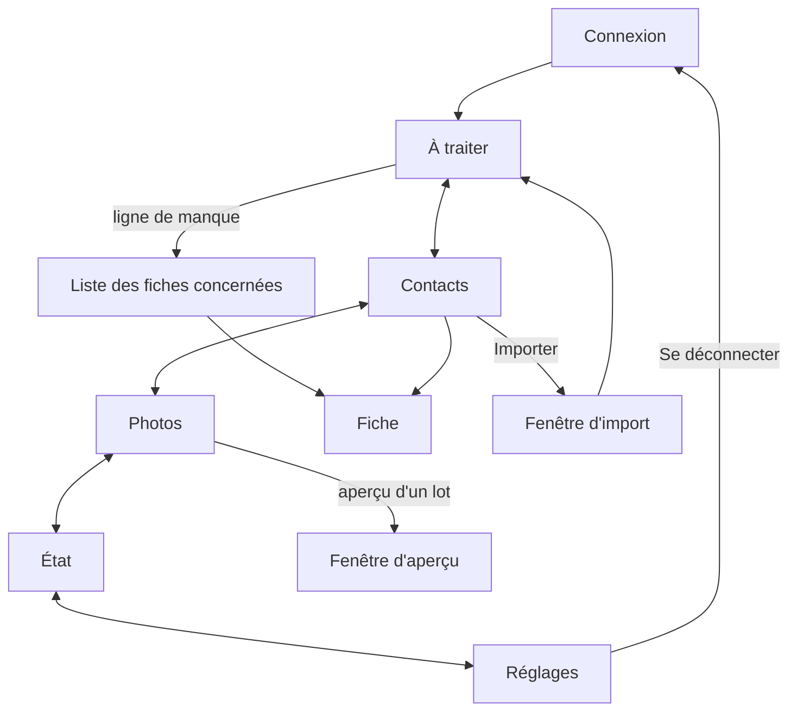

# carnet 2.8.0 — dossier (parcours et complétude)

Rédigé le 11/11/2026. Version : 3, après le conseil (`docs/2.8-conseil.md`) et l'essai (`docs/essai-2.8.md`).

Sources : `docs/2.8-grill.md` (décisions de Julien), `docs/sonde-2.8.md` (mesures sur les vraies données), `docs/essai-2.8.md` (essai en cours), `docs/dossier.md` (carnet tel que construit). Ce dossier ne répète pas ce qui ne change pas.

Une seule livraison. L'essai 2.7.2 est fait ; ses résultats sont intégrés ici.

**Vocabulaire.** *Point* : une décision à prendre dans À traiter. *Manque* : une information attendue et absente ; ce n'est pas une décision. *Attente* : une information qu'un groupe doit avoir. *Exception* : un manque déclaré normal pour un contact. *Affiche* : l'image plein écran qui s'affiche sur l'iPhone quand le contact appelle ; carnet la prépare dans un album Immich, Julien la pose à la main sur l'iPhone. *Filtre* : un bouton rond qui réduit une liste. *Compteur* : le nombre affiché sur l'onglet À traiter.

---

## 1. Besoin

**Le problème.** carnet sait corriger une fiche, pas dire ce qu'il lui manque. La complétude actuelle applique les quatre mêmes critères à tout le monde : un client sans année de naissance est signalé, un proche sans photo ne l'est pas. Les photos se traitent fiche par fiche. L'import a deux entrées. La fiche ignore des informations que l'iPhone sait porter.

**Ce que la 2.8.0 apporte.**

| # | Fonction | En une phrase |
|---|---|---|
| 1 | Attentes par groupe | Un tableau dit quelles informations chaque groupe doit avoir ; il est prérempli et se règle dans l'appli |
| 2 | Manques | À traiter gagne une famille « Manques » : une ligne par information manquante, avec son nombre de fiches |
| 3 | Exceptions | Sur une fiche, « normal pour ce contact » fait taire un manque précis |
| 4 | Onglet Photos | Portraits, affiches iPhone et logos pour plusieurs contacts à la fois |
| 5 | Import unique | Un seul bouton Importer ; carnet reconnaît le fichier et annonce ce qu'il en fera |
| 6 | Champs nouveaux | Service dans la société, prononciation du nom, fête, date de mariage |
| 7 | Fête | Déduite du prénom, écrite dans iCloud, annoncée par Home Assistant pour les groupes qui l'attendent |
| 8 | Mariage | Même date dans iCloud et Treemich : carnet remplit le côté vide, sans validation, et n'écrase jamais |
| 9 | Décès | Une croix devant le nom. La date se saisit sur l'iPhone ou dans carnet et rejoint Treemich ; une date trouvée dans Treemich rejoint iCloud. Arrête les annonces et les manques |
| 10 | Divorce | Lu dans Treemich ; arrête l'annonce de l'anniversaire de mariage |
| 11 | Onglet Réglages | Cinquième onglet : attentes, écritures automatiques, exceptions, connexions aux réseaux, déconnexion |

**Ce que la 2.8.0 ne fait pas.** Nom de naissance, deuxième prénom, date de rencontre, dernier contact, rappels : écartés. Pas de connexion unique. Pas de suppression automatique. Aucune écriture d'un divorce. Pas de flux calendrier ni de module commun à d'autres applis (idées du conseil, gardées pour plus tard). Pas de logo posé sans aperçu.

**Réussi si**, après une semaine :

- Julien règle le tableau des attentes sans aide ;
- la famille « Manques » tient en moins de douze lignes et chaque ligne mène à une liste où il peut agir ;
- poser un logo glissé prend moins de trente secondes par fiche, et la ligne « Sans photo ni logo » baisse chaque fois que Julien y passe du temps ;
- la liste « écrit par carnet tout seul » ne contient aucune ligne que Julien n'aurait pas voulue.

---

## 2. Technique

Pile inchangée : FastAPI, SQLite, Svelte 5, Tailwind 4, image en 3 étapes, port 8096, Watchtower désactivé.

### Ce que la sonde a mesuré (étape 0)

| Constat | Conséquence |
|---|---|
| 563 fiches, aucune validée | La validation d'une fiche entière ne sert pas aujourd'hui ; elle est gardée mais ne porte pas la conception |
| 437 fiches incomplètes avec le tableau de départ, dont 406 faute de photo ou de logo | La ligne « Sans photo ni logo » sera énorme le premier jour ; l'onglet Photos est le moyen de la réduire |
| Hors photo : 59 sans téléphone, puis moins de 20 fiches par ligne | La famille « Manques » reste lisible |
| Aucune fiche ne porte de date supplémentaire, de service ni de prononciation | Pas de reprise de données ; mais rien ne prouve encore qu'iCloud rend ces champs comme attendu |
| 63 fiches sans prénom (62 entreprises) | Ni fête ni naissance attendues pour une fiche d'entreprise |
| 36 prénoms composés ou en plusieurs mots | Il faut une règle pour la fête |
| Un groupe personnel de 46 contacts et « Moi » sans attentes | Le premier reçoit les attentes d'Amis ; « Moi » n'en a aucune |
| 51 contacts dans plusieurs groupes | Les attentes s'additionnent |
| Treemich : 13 couples, aucune date de mariage, aucun décès | Tout part de zéro ; les premières dates viendront de la saisie |

### Champs nouveaux dans la carte iCloud

| Information | Écriture dans la carte | Remarque |
|---|---|---|
| Service | Deuxième partie de `ORG` (`Société;Service`) | Champ natif |
| Prononciation | `X-PHONETIC-FIRST-NAME`, `X-PHONETIC-LAST-NAME` | Champs natifs d'Apple |
| Mariage | Date supplémentaire (`X-ABDATE`) avec le libellé libre « Mariage » | Le libellé natif d'Apple s'affiche « fête » en français : il n'est jamais utilisé |
| Fête | Date supplémentaire avec le libellé libre « Fête », sans année | L'an 1604 veut dire « sans année », avec ou sans le paramètre d'Apple |

Le décès suit le même principe : date supplémentaire avec le libellé libre « Décès ».

### Essai préalable (2.7.2) — fait

Résultats dans `docs/essai-2.8.md`. En bref : iCloud garde tous les champs ; l'iPhone les affiche sur la fiche mais **rien n'apparaît dans Calendrier** ; en modifiant une carte, l'iPhone change l'ordre des lignes, ajoute `type=pref` et retire le paramètre de la date sans année ; la recherche automatique de logos ne peut traiter que 19 fiches sur 210 et en réussit 29 %.

Les trois questions posées étaient :

1. iCloud garde-t-il ces champs tels quels, et **où l'iPhone les montre-t-il** (fiche seulement, calendrier, rappel) ? Le libellé natif d'Apple et un libellé libre « Mariage » sont essayés tous les deux.
2. Comment iCloud réécrit-il la carte (numérotation des libellés, format des dates) ? carnet devra comparer des valeurs remises en forme, pas des lignes, sinon il prendra sa propre écriture pour un changement.
3. Quelle part des sociétés sans photo a un site ou un courriel professionnel, et quelle part des logos est trouvée ?

Décisions prises : la fête est écrite quand même (Julien veut la voir sur la fiche) ; l'attente « photo ou logo » est gardée pour Clients et Artisans, et le logo se pose surtout **à la main, en le glissant** (voir Photos).

### Logo glissé

- Sur la fiche et dans la file Logos, une zone accepte : une image glissée depuis une autre fenêtre du navigateur, un fichier image glissé, une image ou une adresse d'image collée. Sur iPhone : coller, ou choisir dans Photos.
- Un bouton « Chercher sur Google Images » ouvre la recherche dans un nouvel onglet, avec le nom de la société. Google ne se laisse pas afficher dans une autre appli : la recherche se fait dans son onglet, le logo se glisse ou se colle dans carnet.
- Quand le navigateur ne donne qu'une adresse, c'est carnet qui télécharge l'image. Garde-fous : adresses `http` et `https` seulement, jamais vers le réseau local, 3 Mo au plus, image lisible exigée.
- L'image passe par la fabrication actuelle (photo ronde, affiche) et par l'aperçu avant écriture.

### Treemich

Lu dans le code source de Treemich le 11/11/2026.

| Besoin | Appel | Sens |
|---|---|---|
| Date de mariage et de divorce d'un couple | `GET /relationships` (déjà appelé par carnet) : `marriageAnniversaryDate`, `divorceDate` sur chaque lien de conjoint | Lecture |
| Écrire une date de mariage | `PATCH /people/<id>/relationships` avec `toPersonId` et `marriageAnniversaryDate` | Écriture |
| Décès | `deathDate` de la personne | Lecture |

| Écrire un décès | `PATCH /people/<id>` avec `deathDate` | Écriture |

Aucun appel supplémentaire par personne : la lecture du mariage ne coûte rien de plus que la nuit actuelle.

L'écriture du mariage a été lue dans le code, jamais exécutée, et la version de Treemich installée suit `latest`. Donc : après chaque écriture dans Treemich, carnet relit la valeur ; si elle ne correspond pas, il coupe l'interrupteur et le signale dans État. Le corps envoyé ne contient que le champ voulu (jamais `divorceDate`).

### Fête

- Un calendrier des fêtes est embarqué dans l'image (`app/fetes.json`) : prénom vers jour et mois. Pas d'appel réseau.
- Source de départ : le jeu « Les saints et fêtes du calendrier » de data.gouv.fr (Licence Ouverte). Publié par un particulier, sans documentation : il est contrôlé contre un second calendrier avant d'être embarqué, et les écarts sont tranchés à la main.
- Règle pour les prénoms : le prénom entier d'abord (« Jean-Baptiste » a sa propre fête) ; sinon son premier élément ; accents et casse ignorés.
- Prénom introuvable : manque « Sans fête », avec deux réponses sur la fiche — saisir un jour, ou « normal pour ce contact ».
- Une fête saisie à la main n'est jamais remplacée par le calendrier.

### Garde-fous

- Toutes les écritures passent par la garde existante : mode lecture seule, verrou, contrôle de version de la carte, plafonds de nuit.
- Fêtes : une centaine d'écritures au premier passage (Famille, Amis et le groupe personnel). Elles s'étalent sur plusieurs nuits sous le plafond existant.
- **Deux interrupteurs, éteints à la livraison** : « écrire les fêtes », « accorder les dates de famille avec Treemich » (mariage et décès). Tant qu'un interrupteur est éteint, Réglages montre la liste de ce que carnet écrirait. Julien allume quand la liste lui convient.
- **Dates de famille : remplir, jamais écraser.** Une date présente d'un côté et absente de l'autre est copiée. Deux dates différentes : point « Date différente » dans À traiter. Une date effacée d'un côté n'est jamais effacée de l'autre.
- Mariage dans iCloud : la date vit sur la carte de chaque conjoint qui a une fiche liée à Treemich. Un seul conjoint avec fiche : une seule carte écrite. Deux cartes aux dates différentes : point dans À traiter.
- **Treemich n'a pas de sauvegarde côté carnet.** Chaque écriture dans Treemich est inscrite au journal avec la valeur d'avant ; État la montre et permet de la défaire.
- Si Treemich ne répond pas une nuit, carnet garde le dernier état connu (décès, divorces) : les annonces ne reprennent pas par erreur.
- Une fête déjà écrite suit le prénom : si le prénom est corrigé, la fête du calendrier est recalculée ; une fête saisie à la main ne bouge pas.
- Mise en service en lecture seule le premier jour, comme pour la 2.7.0.

### Composants d'interface

Pas de shadcn-svelte ni de TypeScript dans cette version (avis du conseil) : la fenêtre de dialogue et la case à cocher natives du navigateur suffisent, habillées par les classes de carnet. L'écart avec le socle est noté dans `docs/dossier.md`.

---

## 3. Parcours des clics et des écrans

### Vue d'ensemble

**Navigation.** Cinq onglets : À traiter, Contacts, Photos, État, Réglages. Sur iPhone, icônes seules et nom de l'onglet actif, comme aujourd'hui. Sur PC, rail à gauche. La pastille d'À traiter ne compte que les décisions, jamais les manques.

### À traiter

Inchangé pour les décisions. Ajouts :

| Geste | Effet | Écran suivant |
|---|---|---|
| Pastille « Manques » | Affiche une ligne par manque : « Sans photo ni logo (406) », « Sans téléphone (59) »… et « Sans groupe » | À traiter |
| Ligne de manque | Ouvre Contacts filtré sur ce manque | Contacts |
| Ligne « Sans photo ni logo » | Propose aussi « Traiter dans Photos » | Photos |
| Point « Date de mariage manquante » (couple connu de Treemich, sans date) | Saisir la date ; ou « Pas de mariage ni PACS » | À traiter, point retiré |
| Point « Date différente » pour un mariage | Choisir une date, écrite des deux côtés ; ou Ignorer | À traiter, point retiré |

« Pas de mariage ni PACS » vaut pour le couple : la question n'est plus posée pour aucun des deux. Un filtre de Contacts (« Sans union déclarée ») retrouve ces fiches.

« Ignorer » sur une date différente ne repose plus la question tant qu'aucune des deux dates ne change.

Sur iPhone, une ligne de manque de plus de 50 fiches ne propose pas de tout cocher : elle ouvre la liste, filtrable par groupe.

### Contacts

| Geste | Effet | Écran suivant |
|---|---|---|
| Pastilles de manque | Une par information du tableau des attentes (remplacent les quatre « Sans … » actuelles) ; plus « Sans groupe », « Sans union déclarée » et « Décédés » | Contacts |
| Importer | Ouvre la fenêtre d'import | Fenêtre d'import |

**Fenêtre d'import.** Déposer un fichier. carnet annonce ce qu'il a reconnu (« Export LinkedIn, 212 relations ») et ce qu'il va faire, puis attend « Importer ». Un lien « Comment obtenir ce fichier » ouvre le mode opératoire de chaque type : cartes `.vcf`, tableur `.csv`, LinkedIn, Facebook, Instagram. Fichier non reconnu : message clair, rien n'est fait.

### Fiche

| Changement | Détail |
|---|---|
| Nom | Une croix (†) devant le nom d'une personne décédée, sur la fiche et dans toutes les listes |
| Informations | Champs Service, Prononciation, Fête, Mariage, Décès (date, ou simple case « décédé(e) » si la date n'est pas connue) |
| Bloc Complétude | Liste les attentes des groupes du contact : remplies, manquantes, exceptées. Chaque manque a un bouton « Normal pour ce contact » |
| Jauge autour de l'avatar | Part des attentes remplies ; une exception compte comme remplie |
| Validation | « Valider la fiche » reste et couvre tout |

### Photos (`#/photos`, nouveau)

Quatre files, chacune avec son nombre de fiches et un filtre par groupe.

| File | Ce qu'elle montre | Action par lot |
|---|---|---|
| Portraits proposés | Contacts liés à Immich, sans photo, avec un portrait candidat | Cocher, voir l'aperçu, « Poser les portraits » |
| Logos | Toutes les fiches de société sans logo | Par fiche : glisser ou coller un logo, ou « Chercher sur Google Images ». Par lot, pour les fiches qui ont un site : « Chercher les logos », cocher, « Poser les logos » |
| Affiches à préparer | Contacts avec photo, sans affiche | « Préparer les affiches » (dans l'album Immich) |
| Affiches à poser | Affiches prêtes, pas encore posées sur l'iPhone | « Marquer comme posées » |

Rien n'est écrit dans iCloud sans l'aperçu. La recherche de logos se fait par paquets, avec l'anneau de progression ; un logo introuvable laisse la fiche dans la file avec la mention « rien trouvé ».

### État

Perd la section Réseaux (partie vers Réglages et vers l'import) et « Se déconnecter ». La tuile Complétude devient « Manques » : les mêmes lignes qu'À traiter, en lecture.

Nouvelle tuile **« Écrit par carnet tout seul »** : fêtes, mariages et décès écrits dans iCloud ou Treemich, par nuit, avec la valeur d'avant et un bouton « Défaire ».

### Réglages (`#/reglages`, nouveau)

| Section | Contenu | Gestes |
|---|---|---|
| Attentes par groupe | Tableau : une ligne par groupe, une colonne par information | Cocher, décocher ; l'effet sur le nombre de manques s'affiche avant d'enregistrer |
| Écritures automatiques | Deux interrupteurs : fêtes ; dates de famille avec Treemich. Sous chacun, tant qu'il est éteint : « ce que carnet écrirait » | Lire la liste, allumer, éteindre |
| Exceptions | Toutes les exceptions « normal pour ce contact », par information | Retirer une exception |
| Réseaux | Connexions LinkedIn et Telegram ; personnes sans fiche | Comme aujourd'hui dans État |
| Session | Se déconnecter | |

Sur iPhone, le tableau des attentes se lit groupe par groupe (un groupe, sa liste de cases), pas en grille.

La colonne « Fête » vaut pour tout : un groupe qui l'attend voit sa fête écrite dans iCloud et annoncée par Home Assistant. Les colonnes « Immich » et « Treemich » se lisent « relié à une personne d'Immich », « relié à une personne de l'arbre ».

---

## 4. Design

Habillage de la 2.7.0, sans changement de principe.

- **Réglages** : le tableau des attentes est le seul écran dense. Filets fins, cases ocre quand elles sont cochées, en-têtes de colonnes fixes sur PC.
- **Photos** : tuiles bento pour les quatre files en haut (nombre en grand), puis une grille de vignettes rondes pour les portraits et carrées pour les logos. La case cochée est ocre.
- **Manques** : lignes sobres, le nombre à droite, pas de couleur d'alerte : un manque n'est pas une erreur.
- **Fiche** : une exception s'affiche en gris, barrée d'un filet, pas en rouge.
- Éléments gardés : anneau de progression, jauge autour de l'avatar, index en tranche.

---

## 5. Schéma de données

Schéma en version 3. Uniquement des ajouts : la 2.7.1 peut rouvrir la base sans rien perdre.

| Table | Clé | Contenu |
|---|---|---|
| `attentes` | (groupe, information) | Une ligne par case cochée du tableau |
| `exceptions` | (uid, information) | « Normal pour ce contact » |
| `unions` | couple Treemich (les deux identifiants, le plus petit d'abord) | Dernier état lu (date, divorce), réponse « pas de mariage ni PACS » |
| `deces` | `uid` | Décès connu de carnet : date si elle existe, origine (`icloud`, `treemich`, `main`) |
| `fetes` | `uid` | Jour et mois, origine (`calendrier` ou `main`), date d'écriture dans iCloud |
| `logos_cherches` | `uid` | Date et résultat de la dernière recherche, pour ne pas rechercher chaque nuit |

**Informations du tableau** (colonnes) : téléphone, courriel, adresse, jour de naissance, année de naissance, photo ou logo, Immich, Treemich, liens familiaux, société et fonction, fête.

**Calculé, jamais stocké** : la liste des manques d'une fiche (attentes de ses groupes, moins ce qui est rempli, moins ses exceptions), la jauge.

**Dans les tables existantes** : les deux interrupteurs dans `kv` ; chaque écriture automatique dans `journal`, avec la valeur d'avant.

**Au premier démarrage** : le tableau de départ du grill est inscrit dans `attentes` s'il est vide ; le groupe personnel de 46 contacts reçoit les attentes d'Amis.

**Routes pour Home Assistant** : `/ha/fetes` (nouvelle), `/ha/anniversaires` complétée par les mariages ; les personnes décédées et les couples divorcés en sont retirés.

---

## 6. Plan d'implémentation

Chaque étape se vérifie seule. Les tests existants (85 du back, 20 d'interface) ne sont pas réécrits ; on en ajoute.

| # | Étape | Vérification |
|---|---|---|
| 0 | **Essai 2.7.2** : carte d'essai dans iCloud, mesure des logos | Fait le 11/11/2026 |
| 1 | Calendrier des fêtes : construire `fetes.json`, contrôlé sur les prénoms réels de Famille, Amis et du groupe personnel (une centaine), pas sur le calendrier entier | La liste des prénoms introuvables est lue par Julien |
| 2 | Schéma version 3 et tableau de départ | La 2.7.1 rouvre la base ; test ajouté |
| 3 | Calcul des manques, exceptions, jauge | Une commande de contrôle retrouve sur les vraies données les nombres de la sonde (437, 406, 59) |
| 4 | Famille « Manques » dans À traiter, filtres de Contacts | Test : les nombres des lignes sont ceux du calcul ; le compteur de l'onglet ne bouge pas |
| 5 | Onglet Réglages : attentes, exceptions, réseaux déplacés, déconnexion | Test d'interface : cocher une case change le nombre de manques |
| 6 | Onglet Photos : quatre files, leurs lots, logo glissé ou collé | Rien n'est écrit sans aperçu ; test en lecture seule ; une adresse du réseau local est refusée |
| 7 | Champs nouveaux dans le modèle et l'édition de la fiche ; comparaison sur valeurs remises en forme | Test avec la carte de l'essai avant et après sa modification sur l'iPhone : seule la date changée est vue comme un changement ; les propriétés inconnues survivent |
| 8 | Fête : calcul, interrupteur, liste « ce que carnet écrirait », écriture par lots la nuit, `/ha/fetes` | Interrupteur éteint : zéro écriture ; plafond de nuit respecté ; fête saisie à la main conservée |
| 9 | Mariage, décès, divorce : lecture, interrupteur, remplissage du côté vide, relecture après écriture dans Treemich, points d'À traiter, croix devant le nom | Tests : date d'un seul côté, identiques, différentes, effacée, un seul conjoint avec fiche, « pas de mariage », Treemich muet |
| 10 | Tuile « Écrit par carnet tout seul » et « Défaire » | Une écriture d'essai est défaite des deux côtés |
| 11 | Import unique et modes opératoires | Chaque type de fichier d'essai est reconnu ; un fichier inconnu ne fait rien |
| 12 | Mise en service en lecture seule un jour, interrupteurs éteints | Copie de `/state` avant ; retour possible par `CARNET_VERSION` |
| 13 | Julien allume « fêtes » ; une semaine plus tard, « dates de famille » | La tuile « Écrit par carnet tout seul » est relue après chaque première nuit |

**Ligne de coupe.** Si la version s'enlise, l'étape 11 (import unique) sort et part en 2.8.1. Rien d'autre ne dépend d'elle.

**Retour arrière.** L'image 2.7.1 reste publiée. Les fêtes et les mariages écrits dans iCloud ne sont pas retirés par un retour arrière : la sauvegarde quotidienne d'iCloud et la remise fiche par fiche restent le recours.

---

## Ce que le conseil a changé (11/11/2026)

Détail dans `docs/2.8-conseil.md`.

| Sujet | Version 1 | Version 2 |
|---|---|---|
| Avant de coder | Carte d'essai en étape 1 | Essai 2.7.2 à part : carte d'essai et mesure des logos |
| Écritures sans validation | Actives dès la mise en service | Deux interrupteurs éteints, liste « ce que carnet écrirait » |
| Mariage | Mémoire de la dernière date accordée | Remplir le côté vide, ne jamais écraser ni effacer |
| Décès | Lu dans Treemich seulement | Croix devant le nom ; date saisie sur l'iPhone ou dans carnet, accordée avec Treemich |
| Fête par groupe | Deux réglages (attendue, annoncée) | Une seule case |
| Treemich | Aucun recours | Journal avec valeur d'avant, « Défaire », relecture après écriture |
| Exceptions | Sans retour | Liste dans Réglages |
| Composants | shadcn-svelte et TypeScript | Natifs du navigateur |
| Plan | Import en étape 8 | Import en dernier, sacrifiable |
