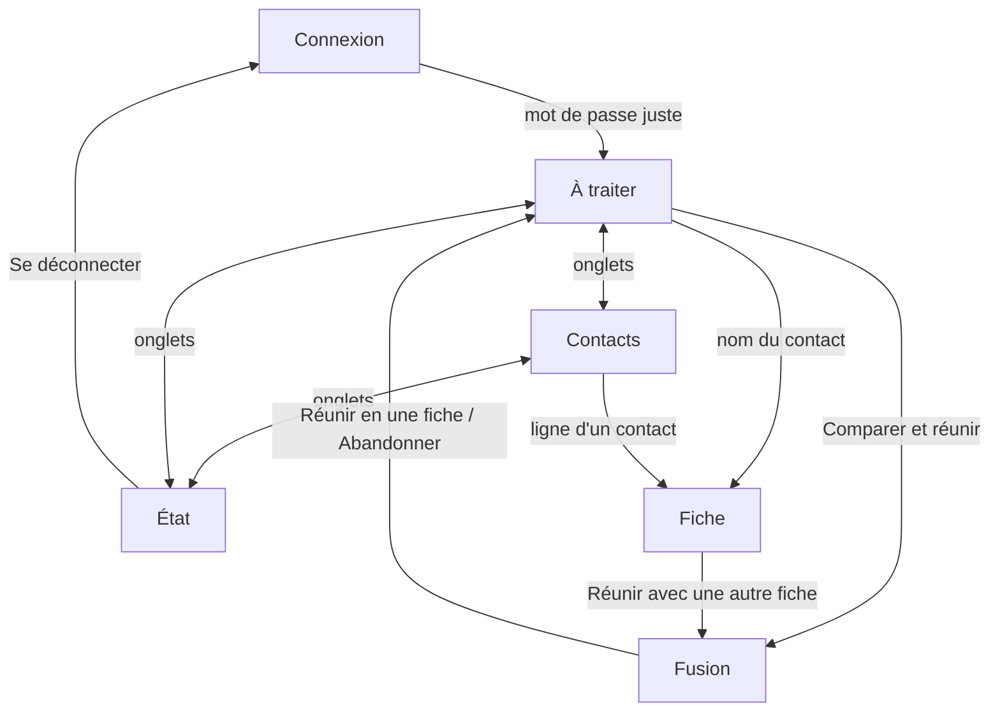

# Dossier de carnet — tel que construit (version 2.6.4), mis à jour pour la 2.6.5

> **Depuis la 2.8.0**, ce dossier n'est plus à jour sur trois points : la complétude (remplacée par les attentes par groupe), la navigation (cinq onglets : Photos et Réglages s'ajoutent) et le schéma (version 3). Voir `docs/2.8-dossier.md`, qui fait foi pour ces sujets jusqu'à la prochaine mise à jour de ce document.

Rédigé le 11/11/2026 à partir du code, sans modifier celui-ci. Six sections, puis la liste des écarts par rapport au socle commun (`baloodusudouest/socle`).

Ce dossier décrit ce qui existe. Ce qui doit changer est dans « Écarts » et dans le plan de la section 6.

---

## 1. Besoin

**À quoi sert carnet.** Garder des fiches de contacts propres et uniformes dans iCloud, qui reste la seule source : carnet relit iCloud, propose des corrections, relie chaque personne à Immich, Treemich et aux réseaux, puis écrit dans iCloud ce que Julien a validé.

**Pour qui.** Un seul utilisateur, sur iPhone et sur PC, par le réseau local ou Tailscale.

**Ce que fait la version 2.6.4.**

| Fonction | Ce qu'elle fait |
|---|---|
| Lecture d'iCloud | Lit toutes les cartes et les groupes par CardDAV ; garde la carte d'origine pour réécrire sans rien perdre |
| À traiter | Boîte unique des points à trancher : fiche modifiée, créée ou supprimée sur l'iPhone, conflit, doublon, forme à uniformiser, émoji sans groupe, liaison Immich proposée, date différente selon les services, nom différent, rapprochement réseau, liens familiaux, import |
| Modification | Édition d'une fiche avec aperçu de « ce qui part dans iCloud » avant écriture ; annulation possible pendant 10 secondes |
| Fusion | Réunir deux fiches en une ; liaisons, photo, affiche et relation LinkedIn suivent |
| Complétude | Quatre critères (année de naissance, adresse, téléphone, moyen de contact), validation d'une fiche, filtres « Sans … » |
| Liaisons | Une personne Immich et une personne Treemich par contact ; liaisons sûres faites seules la nuit |
| Réseaux | LinkedIn (API ou fichier), Telegram (import ponctuel), Facebook et Instagram (archives), X et WhatsApp (saisie sur la fiche) |
| Photos | Portrait recadré depuis les visages Immich, affiche plein écran pour l'iPhone, logo de société |
| Nuit | Chaque nuit : sauvegarde, relecture d'iCloud, écritures sûres, liaisons sûres, copie Synology Contacts |
| Sauvegardes | Copie d'iCloud avant la première écriture du jour et chaque nuit ; comparaison et restauration fiche par fiche ; export `.vcf` |
| Sorties | Copie vers Synology Contacts, contacts d'urgence vers le kit d'urgence, routes `/ha/…` pour Home Assistant (contacts, anniversaires, invité, portraits) |

**Non-objectifs constatés.** Pas de multi-utilisateur. Pas d'import Gmail ni Outlook (retirés en 2.0). Pas d'écriture automatique d'une modification faite sur l'iPhone : tout repasse par « À traiter ». Aucune suppression automatique.

---

## 2. Technique

| Élément | Choix |
|---|---|
| Back | Python 3.12, FastAPI, Uvicorn ; 32 fichiers dans `app/`, environ 7 300 lignes |
| Front | Svelte 5, Vite 6, Tailwind 4, JavaScript ; 6 écrans et 10 composants, environ 2 650 lignes ; composants et styles faits main |
| Base | SQLite, fichier `carnet2.db` dans `/state` |
| Image | Dockerfile en 3 étapes, publiée sur `ghcr.io/baloodusudouest/carnet` avec les étiquettes `latest`, version et commit |
| Déploiement | Service `carnet` de `homelab.yml`, port 8096, Watchtower désactivé (carnet écrit dans iCloud) |
| Tests | 80 tests du back sur des contacts fictifs, 19 tests d'interface dans un vrai navigateur (PC et iPhone), lancés par GitHub Actions |

**Services externes.**

| Service | Protocole | Sens | Réglage |
|---|---|---|---|
| iCloud Contacts | CardDAV | lecture et écriture | `CARNET_ICLOUD_USER`, `CARNET_ICLOUD_PASSWORD` (mot de passe d'application) |
| Immich | API REST | lecture, écriture des noms et dates de naissance, album d'affiches | `CARNET_IMMICH_CLE` |
| Treemich | API REST, une seule session réutilisée | lecture, écriture des dates et noms | `CARNET_TREEMICH_EMAIL`, `CARNET_TREEMICH_PASSWORD` |
| Synology Contacts | CardDAV | écriture (copie) | `CARNET_SYNOLOGY_URL`, `CARNET_SYNOLOGY_PASSWORD` |
| LinkedIn | API de portabilité (OAuth) ou fichier | lecture | `CARNET_LINKEDIN_CLIENT_ID`, `CARNET_LINKEDIN_CLIENT_SECRET` |
| Telegram | Telethon, session en mémoire | lecture ponctuelle | `CARNET_TELEGRAM_API_ID`, `CARNET_TELEGRAM_API_HASH` |
| Kit d'urgence | fichier partagé + appel HTTP | écriture | `KIT_URL`, `KIT_API_TOKEN` |
| Home Assistant | carnet est interrogé, jeton porteur | lecture par HA | `CARNET_HA_TOKEN` |

**Connexion.** Un mot de passe (`CARNET_PASSWORD`), cookie de session signé valable 30 jours ; « Se déconnecter » invalide tous les cookies. Délai de 1 seconde par essai, 5 secondes après 5 échecs. Les routes `/ha/…` demandent un jeton distinct.

**Garde-fous d'écriture.** Verrou tenu pendant toute une opération. Contrôle de version de la carte (ETag) avant et après écriture. Coupe-circuit si la lecture d'iCloud est partielle ou si plus de 5 % des fiches disparaissent. Pause de 15 minutes après un refus d'identifiants iCloud. Plafonds de créations et de modifications la nuit.

---

## 3. Parcours des clics et des écrans

Adresses de la forme `#/page/…`. Largeur de 900 px et plus : mode PC (liste et détail côte à côte). En dessous : mode iPhone (un écran à la fois).

### Vue d'ensemble

**Navigation permanente.** Trois onglets : À traiter (pastille du nombre de points), Contacts, État (roue si une opération tourne, point rouge si un problème). Sur iPhone : pilule flottante en bas, l'onglet actif s'élargit avec son nom. Sur PC : rail à gauche.

**Message bref.** Après chaque écriture, un message apparaît en bas 4 secondes ; il porte un bouton « Annuler » pendant 10 secondes quand l'écriture est réversible ; une erreur reste 8 secondes.

### Connexion

| Geste | Effet | Écran suivant |
|---|---|---|
| Saisir le mot de passe, valider | Session ouverte | À traiter |
| Mot de passe faux | Message d'erreur après le délai | Connexion |

### À traiter (`#/a-traiter`, écran d'ouverture)

| Geste | Effet | Écran suivant |
|---|---|---|
| Pastille de filtre (Tout, puis une par famille de motifs) | Réduit la liste | À traiter |
| Bouton de lot, visible quand un filtre est actif | Demande confirmation, puis traite tous les points visibles | À traiter |
| PC : clic sur un point du sommaire | Affiche le point à droite | À traiter |
| Nom du contact dans un point | Ouvre la fiche | Fiche |
| Bouton plein d'un point | Applique la réponse attendue (voir tableau suivant) | À traiter, point retiré |
| Second bouton d'un point | Applique l'autre réponse | À traiter, point retiré |

**Réponses par motif.** Le bouton plein est cité en premier.

| Motif | Boutons |
|---|---|
| Fiche modifiée sur l'iPhone | Garder ; Revenir à avant |
| Fiche créée sur l'iPhone | Garder ; Corriger (ouvre la fiche) |
| Fiche supprimée sur l'iPhone | Confirmer la suppression ; Remettre la fiche |
| Conflit | Garder l'iPhone ; Écrire ma version |
| Import | Créer dans iCloud ; Ignorer |
| Doublon | Comparer et réunir (ouvre Fusion) ; Pas la même personne |
| Liaison Immich | Lier ; Pas lui |
| Date différente | Écrire partout (après choix d'une date) ; Ignorer |
| Nom différent | Renommer dans le service ; Ignorer |
| Rapprochement réseau | Lier ; Lier et ajouter le numéro ; Pas lui |
| Liens familiaux | Ajouter à la fiche ; Ignorer |
| Forme, émoji, LinkedIn | Appliquer ; Ignorer |

### Contacts (`#/contacts`)

| Geste | Effet | Écran suivant |
|---|---|---|
| Champ de recherche | Filtre par nom, société, numéro | Contacts |
| Prénom / Nom | Change le tri, retenu sur l'appareil | Contacts |
| Menu Groupes | Filtre par groupe | Contacts |
| Pastilles « Sans année », « Sans adresse »… | Filtre par manque | Contacts |
| Importer | Envoie un fichier `.vcf`, `.csv`, `.zip` ou `.json` ; les fiches arrivent dans À traiter | Contacts |
| Lettre de l'index (tranche sur PC, index au pouce sur iPhone) | Saute à la lettre | Contacts |
| Ligne d'un contact | iPhone : ouvre la fiche. PC : l'affiche à droite | Fiche |

### Fiche (`#/contacts/<identifiant>`)

Six blocs empilés : points à traiter de cette fiche, informations, complétude, plateformes, liaisons, photo et affiche, réunir.

| Geste | Effet | Écran suivant |
|---|---|---|
| « Contacts » (iPhone) | Retour à la liste | Contacts |
| Stylo | Passe en modification | Fiche (édition) |
| Voir les changements | Affiche « Ce qui part dans iCloud » | Fiche (aperçu) |
| Écrire dans iCloud | Écrit, message avec Annuler | Fiche |
| Continuer à modifier / Abandonner | Retour à l'édition / à la lecture | Fiche |
| Numéro, courriel | Lance l'appel ou le courriel | hors appli |
| Valider la fiche / Revalider / Retirer la validation | Change le statut de complétude | Fiche |
| Ajouter un profil (choix du réseau, saisie, Ajouter) | Écrit le profil dans la carte iCloud | Fiche |
| Délier un réseau, puis confirmer | Retire le profil de la carte | Fiche |
| Chercher dans Immich et Treemich, puis Lier | Crée la liaison | Fiche |
| Délier une liaison | Retire la liaison | Fiche |
| Bloc Photo et affiche | Choisir un portrait, préparer l'affiche, choisir un logo | Fiche |
| Réunir : saisir un nom, choisir la fiche | Ouvre la fusion | Fusion |

### Fusion (`#/fusion/<a>/<b>`)

| Geste | Effet | Écran suivant |
|---|---|---|
| Choisir la carte gardée | L'autre sera retirée d'iCloud | Fusion |
| Modifier les champs réunis | Prépare la fiche finale | Fusion |
| Réunir en une fiche | Écrit, message avec Annuler | À traiter |
| Abandonner | Rien n'est écrit | À traiter |

### État (`#/etat`)

Un bandeau de bilan, puis sept tuiles ; un clic sur une tuile ouvre sa section en dessous.

| Section | Gestes |
|---|---|
| iCloud et la nuit | Relire iCloud ; Lancer la nuit maintenant ; forcer la lecture après un coupe-circuit |
| Sauvegardes | Choisir une sauvegarde, la télécharger, cocher des fiches et les remettre ; Exporter tout le carnet |
| Copies | Copier vers Synology (et Forcer la copie) ; Envoyer au kit |
| Réseaux | LinkedIn (fichier, connexion, adresse de retour), Telegram (numéro, code, import), Facebook et Instagram (archives) ; rattacher les personnes sans fiche |
| Complétude | Relancer l'analyse globale ; Remettre les validations à zéro (en tapant REMETTRE) |
| Services | Voyant par service ; Relire Immich et Treemich |
| Journal | Lecture seule |
| Pied de page | Se déconnecter |

### Points de friction relevés en lisant le parcours

1. **Deux entrées pour importer** : le bouton « Importer » de Contacts et les dépôts de fichiers de la section Réseaux d'État.
2. **La section Réseaux est un écran dans l'écran** : six réseaux, trois façons d'importer, quatre listes de personnes sans fiche, le tout dans un bloc d'État.
3. **La fiche empile six blocs** : sur iPhone, les liaisons et la photo sont loin sous les informations.
4. **« Se déconnecter » n'existe qu'en bas d'État.**
5. **Rien n'indique sur À traiter ce que fera un traitement par lot avant d'avoir choisi un filtre.**

---

## 4. Design

**Depuis la 2.7.0.** Minimalisme chaleureux, base du socle commun : fonds neutres teintés vers l'ocre (anthracite chaud en sombre, blanc cassé en clair), filets fins, peu de surfaces pleines. Texte en Inter ; titres d'écran grands et fins, noms plus fermes. Sombre par défaut, clair quand l'appareil le demande.

**L'ocre** est la couleur de carnet. Il porte l'action attendue (un seul bouton plein par bloc), le filtre actif, le compteur d'À traiter, le motif d'un point et la valeur modifiée.

**Éléments propres à carnet, gardés :** l'anneau de progression des boutons, la jauge de complétude autour de l'avatar, l'index alphabétique en tranche sur PC.

**État** : un bandeau de bilan, puis des tuiles bento ; « iCloud et la nuit » occupe deux colonnes.

**Animation.** Transitions courtes sur la barre d'onglets et les boutons ; tout est coupé si l'appareil demande de réduire les animations.

**Avant la 2.7.0** : un carnet d'adresses en cuir sombre, titres en Spectral, sombre uniquement.

---

## 5. Schéma de données

Base SQLite `carnet2.db`, version de schéma 2, une seule connexion sous verrou.

| Table | Clé | Contenu |
|---|---|---|
| `fiches` | `uid` | Carte lue dans iCloud : adresse, version (ETag), texte d'origine, forme lisible, présence d'une photo, date de lecture |
| `groupes` | `uid` | Carte de groupe iCloud et ses membres |
| `a_traiter` | `id` ; unique sur (motif, clé) | Points à trancher, avec leurs données |
| `ignores` | (motif, clé) | Propositions écartées, à ne plus reproposer |
| `liaisons` | (uid, service) ; unique sur (service, identifiant externe) | Lien contact vers Immich ou Treemich, statut `auto` ou `confirmee` |
| `refus` | (uid, service, identifiant externe) | Liaisons refusées |
| `portraits` | `uid` | Candidats Immich et portrait choisi |
| `affiches` | `uid` | Affiche dans l'album Immich et date de pose sur l'iPhone |
| `linkedin` | adresse du profil | Relation LinkedIn, fiche rattachée ou détachée |
| `en_attente` | (uid, motif) | Écritures sûres à faire la nuit |
| `validations` | `uid` | Empreinte de la fiche au moment de sa validation |
| `personnes_externes` | (service, identifiant externe) | Personnes lues dans Telegram, Facebook ou Instagram, purgées à 90 jours |
| `journal` | `id` | Évènements datés |
| `kv` | `cle` | Valeurs isolées : référence iCloud, dernière nuit, génération de session |

**Relations.** Tout se rattache à `fiches.uid`. Aucune clé étrangère déclarée : la cohérence est tenue par le code (fusion, suppression).

**Fichiers.** `/state` : la base, les sauvegardes d'iCloud, l'ancienne base 1.3. `/data` : fichiers déposés à la main. `/kit-config` : contacts d'urgence écrits pour le kit.

---

## 6. Plan d'implémentation

Trois livraisons, décidées le 11/11/2026 après le passage au conseil. Chacune remplace la précédente dans Portainer et se vérifie seule.

### 2.6.5 — ménage, sans toucher l'apparence

Étapes 1 à 4 faites le 11/11/2026. Reste l'étape 5, côté NAS.

| # | Étape | Vérification |
|---|---|---|
| 1 | Retirer les restes de la 1.3 : `sqlcipher3-wheels`, `app/reprise.py`, `CARNET_DB_KEY` | 80 tests du back verts ; l'appli démarre sur la base actuelle |
| 2 | Versions exactes dans `frontend/package.json` | Interface compilée identique |
| 3 | Annonce avant un traitement par lot : ce qui sera écrit, pour combien de fiches | Test d'interface ajouté (ajout, pas réécriture) |
| 4 | Mode lecture seule (`CARNET_LECTURE_SEULE=oui`) : aucune écriture vers iCloud, Immich, Treemich ni Synology | Test du back : toute écriture est refusée et signalée |
| 5 | Mise en service, puis essai réel du retour à la 2.6.4 par `CARNET_VERSION` | L'appli revient et relit la même base |

### 2.7.0 — nouvel habillage seul

Étapes 1 à 6 faites le 11/11/2026 ; l'étape 2 s'est faite sans shadcn-svelte (les classes de carnet portent l'habillage). Reste l'étape 7, côté NAS.

Règles : mêmes textes, même navigation, mêmes rôles d'accessibilité ; les 19 tests d'interface ne sont pas réécrits ; les noms internes dont ils dépendent sont conservés ; deux reprises au plus par écran. L'anneau de progression, la jauge autour de l'avatar et l'index en tranche sont gardés et reteintés.

| # | Étape | Vérification |
|---|---|---|
| 1 | Un écran réel (À traiter) dans le nouvel habillage, en sombre et en clair, sur PC et iPhone | Validé par Julien avant de continuer |
| 2 | Thème et composants de base (bouton, pastille, carte, champ) pour toute l'appli | 19 tests verts ; aucun écran dégradé |
| 3 | Navigation et connexion | Pastille de compte, roue et point rouge visibles |
| 4 | À traiter, point, fusion | Un point de chaque motif affiché sur données fictives |
| 5 | Contacts et fiche | Aperçu « ce qui part dans iCloud » inchangé |
| 6 | État en tuiles bento | Chaque action d'État se lance encore |
| 7 | Mise en service à la place de l'habillage actuel, en lecture seule le premier jour | Essai sur iPhone : clavier, défilement, fenêtres |

### 2.8.0 — parcours et complétude

Évolution fonctionnelle : elle aura son propre grill, son dossier et son passage au conseil. Demandes de Julien du 11/11/2026 :

- une seule entrée pour importer ;
- des filtres de manques plus nombreux : sans Immich, sans photo ni logo, sans liens familiaux, sans année ou sans date de naissance, sans moyen de contact ;
- un écran de réglages disant quelles informations chaque groupe doit avoir (un client ou un artisan sans Immich ni Treemich, c'est normal ; un collègue sans Treemich aussi, mais il devrait avoir une photo) ;
- une section Photos pour choisir et pousser les portraits et les affiches pour l'iPhone, pour plusieurs contacts à la fois ;
- une fiche aussi complète que possible, d'après ce que proposent les applis de contacts.

**Retour arrière.** L'image de chaque version reste publiée : `CARNET_VERSION` dans Portainer suffit à revenir. Copie de `/state` avant chaque mise en service. Côté iCloud, carnet garde déjà une copie complète avant la première écriture de chaque jour et sait remettre une fiche comme dans la sauvegarde.

---

## Écarts par rapport au socle

| # | Écart | Constat | Gravité | Proposition |
|---|---|---|---|---|
| 1 | Habillage | Thème cuir propre à carnet, composants faits main, pas de shadcn-svelte | Voulu | **Fait en 2.7.0** (habillage porté par les classes de carnet ; shadcn-svelte non introduit) |
| 2 | Thème clair | Sombre uniquement (`color-scheme: dark`) | Moyen | **Fait en 2.7.0** |
| 3 | Mot de passe | `CARNET_PASSWORD` propre à carnet, sans longueur minimale ; le socle prévoit `APPS_PASSWORD` commun, 12 caractères au moins | Moyen | **Laissé tel quel** (décision du 11/11/2026) : à revoir avec la connexion unique, quand toutes les applis seront prêtes pour l'Anneau unique |
| 4 | Reste de la 1.3 | `sqlcipher3-wheels`, `app/reprise.py` et `CARNET_DB_KEY` toujours présents alors que la reprise est faite | Faible | **Fait en 2.6.5** |
| 5 | Versions du front | 7 dépendances avec `^` dans `package.json` (le fichier de verrouillage les fige quand même) | Faible | **Fait en 2.6.5** |
| 6 | Fichier de reprise | Absent | Faible | Ajouté avec ce dossier |
| 7 | Langage du front | JavaScript ; les composants shadcn-svelte sont en TypeScript | Faible | Ajouter TypeScript au seul usage des composants ; ne pas convertir l'existant |
| 8 | Poids de l'interface | Non mesuré ; la bibliothèque de graphiques du socle pèse lourd | À surveiller | Ne pas embarquer de graphique dans carnet tant qu'aucun écran n'en a besoin |
| 9 | Friction de parcours | Cinq points relevés en section 3 | Moyen | L'annonce avant un lot en 2.6.5 ; l'import unique et le reste en 2.8.0 |

**Conforme au socle, à garder tel quel :** FastAPI et image en 3 étapes, session par cookie signé (le socle la reprend de carnet), `/health` public, versions du back épinglées, étiquettes d'image permettant le retour arrière, sauvegarde avec restauration, tests du back et de l'interface, aucune donnée personnelle dans le dépôt.
